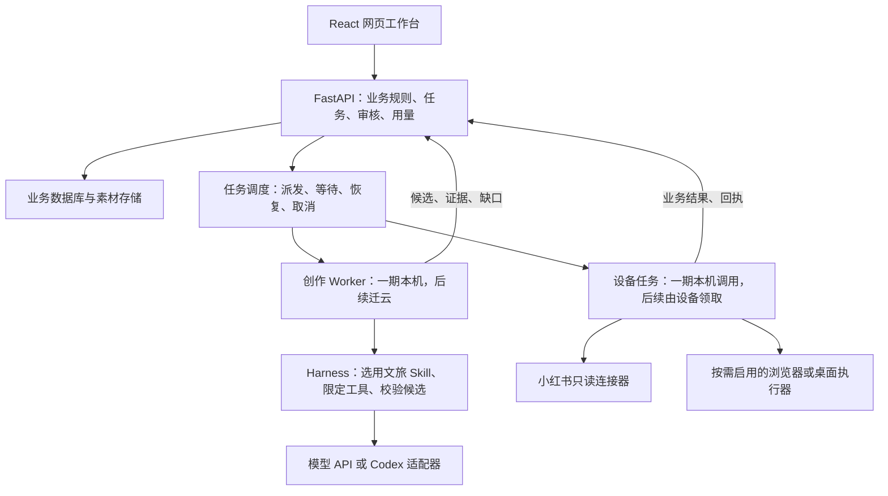

# lead_mind 整体技术方案

架构规划快照 · 2026-11-07

lead_mind 帮助文旅运营把游客问题和真实线路资料转化为小红书图文，再把咨询整理成能交给人工销售的线索。目标形态是云端网页工作台、云端运营调度和按需安装的本地助手。第一阶段在一台电脑上演示同一套业务流程，之后按任务类型逐步迁云。

## 首期交付与已知边界

本机工作区已有参考导入、手工拆解、图文编辑、审核、内容包、发布回填和轻量线索台账。计划新增的重点是把真实模型接入可恢复的分步创作。本机连接器曾通过健康检查，但登录状态接口因鉴权返回 401；真实平台读取、网页辅助填写、平台草稿、模型成稿质量及获客效果均待验证。

首期集中在小红书图文。游客咨询保留原文，线索有效性由运营确认，人工销售，旅行社履约。视频属于第二期。当前发布路径为人工审核、导出、运营在网页最终点击发布、回填结果。定时任务仅提醒。

## 组件与部署位置

| 模块 | 选型与责任 |
| --- | --- |
| 工作台 | React / TypeScript / Vite。通过业务任务 ID 查询步骤，允许运营改选题、局部重做、审核和整理咨询。 |
| 业务服务 | FastAPI / SQLAlchemy。保存来源关系、版本、权限、真实与演示模式；决定候选是否过期、审核是否有效、是否允许准备发布。 |
| 调度与存储 | 首期 Python Worker、SQLite 和本地图片。跨设备时由云端统一持有业务任务。多客户阶段采用 PostgreSQL 和对象存储。待跨天等待、恢复和调度复杂度成为实际瓶颈时再评估持久化工作流引擎。 |
| 创作引擎 | 本地演示拟用 Codex Python SDK 驱动同机 App Server。核心 Skill 为参考拆解、文旅改写；运营选角度是可恢复的中间步骤。模型只能交付候选。商业版通过适配器选择获准的模型服务，保留直接调用商业 API 的路径。 |
| 设备执行 | 首期由本机代码直接调用 xiaohongshu-mcp 只读接口。远程试点先搭配 Python 领取进程，需要安装和升级管理时再交付 Tauri 托盘助手。本地 Codex 仅在任务需要根据本机观察连续判断时按需启用。 |

## 一篇参考笔记的生命周期

1. 运营按需搜索、指定链接或粘贴原文，选定账号、目标游客和有来源的线路。连接器失败时可补录原文。
2. 拆解 Skill 给出游客问题、可复用结构、引文和证据缺口。系统保存这一步，等待运营选择角度。
3. 改写 Skill 按所选角度和自身线路事实生成标题、正文、配图建议及待核事项。参考作者经历、价格和图片不能作为本社可发布事实。只读到文字时，不声称分析过画面。
4. 后端核对来源、输入版本、报价有效期、素材权限，运营审核具体版本。资料或稿件变化要重新校验。AI 返回期间的人工编辑受到保护。
5. 首期导出内容包，人工发布并回填链接。未来辅助填写按标题、正文、图片分别回报，草稿保存单独验证。填入成功、人工发布、发布结果未知分别记账。
6. 将后续咨询关联至已知来源，未知预算和日期保持未知。按线索 ID 统计人工确认的有效线索；同时记录人工修稿时间、事实纠错和采纳情况。

## 三个稳定的接口边界

| 接口边界 | 关键数据 | 恢复原则 |
| --- | --- | --- |
| 业务服务与执行器 | 任务及步骤 ID、数据模式、允许动作、目标记录及版本、幂等键。跨设备后增加租户、设备、领取期限和有效期 | 刷新后查原任务。设备离线时等待，恢复前复核输入版本和授权。 |
| Harness 与创作产物 | 来源与证据、Skill 和模型版本、候选、人工选择、用量 | 从已保存的产物继续；Codex thread ID 仅辅助接续该引擎。上游资料变化时重做受影响步骤。 |
| 设备动作与执行回执 | 目标账号、审核版本、分项结果、错误和时间 | 本机先记录回执再上传。外部动作结果未知时先核对，重复领取不可导致重复操作或重复计费。 |

网页侧可以从提交任务、查询状态和在等待步骤提交选择三个动作起步。首期所有组件同机运行；快速迁云时，同一套网页和 API 可同域部署，本机执行进程通过出站 HTTPS 领取授权任务，设备无需开放入站端口。

## 本地会话、隐私与商业边界

设备保管平台登录态和连接器令牌。读取笔记是确定性动作，可以直接调用工具。需要复用客户当前浏览器页时，优先验证扩展；客户接受专用窗口时，可验证 Browser Use 与独立持久化配置目录。以实际客户流程选择一条。出现验证码或限流时交还用户。原始凭据、临时访问参数和不必要的联系方式不得进入模型、云端回执或日志。即使浏览器在本地，调用远程模型仍须审查页面文字与截图的数据流向。

进入商业阶段后，核心 Skill、编排策略和评测数据留在云端。服务端实施租户隔离、设备配对、可撤销授权、预算和按业务事件去重的用量账本。正式采用托管 Codex 前需确认商用认证路径；本机开发登录不能直接作为收费产品的认证基础。客户专属资料与平台运营知识分别授权。

## 迭代与验收

| 阶段 | 交付 | 进入下一阶段的证据 |
| --- | --- | --- |
| M1 本机演示 | 网页、本机 API、SQLite、本地 Harness 和两个 Skill。以手工导入保底，同时验证连接器真实读取。 | 改选题、刷新、继续生成和导出均可完成。用同一批资料比较人工、单次模型和分步工作流，记录修到可审稿的时间、事实纠错数和每篇成本。 |
| M2 云端网页连接一台设备 | 受控访问的网页、API 和任务库迁云；本机继续执行。单实例试点可沿用持久卷上的 SQLite，并验证数据库和图片恢复。 | 设备离线可见、重连可补回执、不会重复领取同一有效任务。依赖本机的创作仍须等设备上线。 |
| M3 付费试点 | 创作任务和核心 Skill 迁云；设备仅执行本地会话专属动作。交付租户隔离、成本记录、备份与按需安装的助手。 | 关机后云端仍可出稿；设备恢复后再领本地任务；不同客户不可互访；重试不重复扣费。 |
| M4 有限自主运营 | 按运营目标、预算、期限和授权调度，周期复盘内容与咨询；按需扩展浏览器或本地 Agent。 | 以每条有效线索成本、人工接管率和事实纠错率决定是否扩大自主权限。真实获客效果须用实际发布与归因数据验证。 |

## 设计依据

- Codex Python SDK 封装同机 App Server；实际可用接口、运行时版本与认证条件应按选定版本复核。[SDK 文档](https://learn.chatgpt.com/docs/codex-sdk) · [App Server 认证说明](https://learn.chatgpt.com/docs/app-server#authentication-endpoints)
- 平台读取候选和浏览器控制应各自验收。[xiaohongshu-mcp 上游](https://github.com/xpzouying/xiaohongshu-mcp) · [Chrome 默认配置目录的远程调试限制](https://developer.chrome.com/blog/remote-debugging-port)
- 云端发起、设备执行可参照 Power Automate 的桌面流程，以及 GitHub 自托管 Runner 的连接模型。[Power Automate](https://learn.microsoft.com/en-us/power-automate/desktop-flows/run-desktop-flow) · [自托管 Runner](https://docs.github.com/en/actions/reference/runners/self-hosted-runners)
